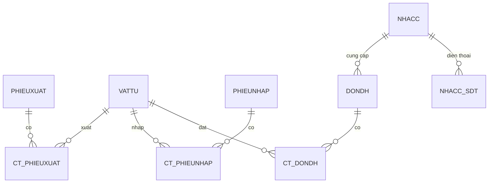

# Chuyển đổi ERD sang mô hình quan hệ

## 1. Thực thể
- PHIEUXUAT(**SoPX**, NgayXuat)
- VATTU(**MaVTU**, TenVTU)
- PHIEUNHAP(**SoPN**, NgayNhap)
- DONDH(**SoDH**, NgayDH)
- NHACC(**MaNCC**, TenNCC, DiaChi, SDT đa trị)

## 2. Phân tích quan hệ
1. Chi tiết phiếu xuất: PHIEUXUAT – VATTU, N–N, thuộc tính DGXuat và SLXuat.
2. Chi tiết phiếu nhập: PHIEUNHAP – VATTU, N–N, thuộc tính DGNhap và SLNhap.
3. Chi tiết đơn đặt hàng: DONDH – VATTU, N–N.
4. Cung cấp: NHACC – DONDH, 1–N, nên thêm MaNCC vào DONDH.

## 3. Thuộc tính đa trị
Thuộc tính SDT của NHACC được vẽ bằng elip kép. Tạo bảng NHACC_SDT(**MaNCC**, **SDT**), với MaNCC đồng thời là khóa ngoại.

## 4. Kết quả: 9 bảng
1. PHIEUXUAT(**SoPX**, NgayXuat)
2. VATTU(**MaVTU**, TenVTU)
3. PHIEUNHAP(**SoPN**, NgayNhap)
4. NHACC(**MaNCC**, TenNCC, DiaChi)
5. DONDH(**SoDH**, NgayDH, MaNCC FK → NHACC)
6. CT_PHIEUXUAT(**SoPX**, **MaVTU**, DGXuat, SLXuat)
7. CT_PHIEUNHAP(**SoPN**, **MaVTU**, DGNhap, SLNhap)
8. CT_DONDH(**SoDH**, **MaVTU**)
9. NHACC_SDT(**MaNCC**, **SDT**)

Các thuộc tính **in đậm** là khóa chính; khóa chính của bảng chi tiết là tổ hợp hai cột. Các cột cùng tên trong bảng chi tiết là khóa ngoại tham chiếu bảng cha.

## Sơ đồ quan hệ

Không thêm các thuộc tính không có trong ERD gốc.
