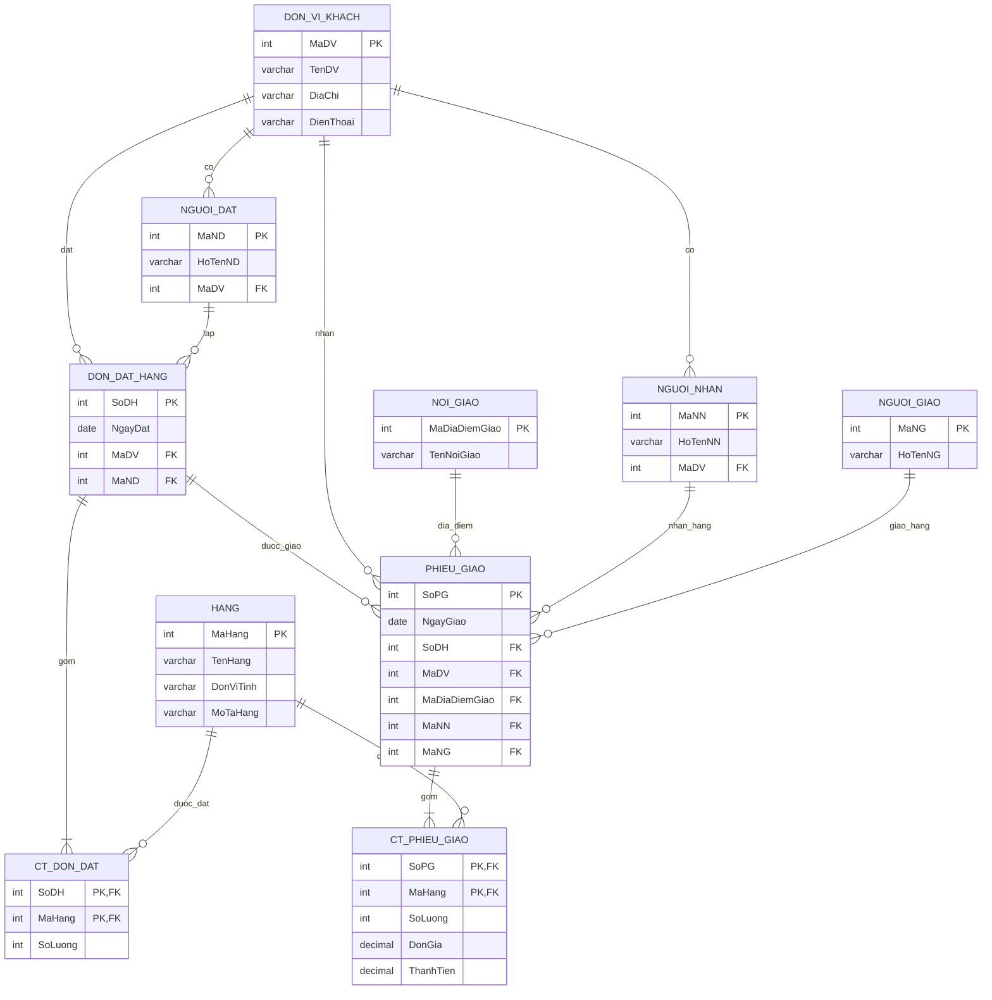

# Thực hành: ERD quản lý đơn đặt hàng

Sơ đồ ERD được thiết kế theo yêu cầu CodeGym, sau khi gộp Đơn vị đặt hàng và Đơn vị khách hàng thành thực thể **DON_VI_KHACH**.

## Sơ đồ ERD

## Các bước thực hiện
1. Liệt kê thông tin của Đơn đặt hàng và Phiếu giao hàng.
2. Xác định các thực thể: Đơn vị khách, Người đặt, Người nhận, Người giao, Nơi giao, Hàng, Đơn đặt hàng, Phiếu giao hàng.
3. Xác định khóa chính (PK), khóa ngoại (FK) và các quan hệ 1–N.
4. Tách quan hệ nhiều–nhiều giữa đơn hàng/phiếu giao và hàng hóa thành **CT_DON_DAT** và **CT_PHIEU_GIAO**.
5. Gộp hai thực thể đơn vị thành **DON_VI_KHACH** để giảm dữ liệu trùng lặp.
6. Hoàn thiện ERD và kiểm tra các liên kết.

## Kết quả
Sơ đồ thể hiện 10 thực thể và các mối quan hệ quản lý đặt hàng và giao hàng. Trường `ThanhTien` là giá trị có thể tính bằng `SoLuong × DonGia`.

## Ghi chú
Đây là một cách mô hình hóa chi tiết từ yêu cầu, không nhất thiết trùng cách bố trí trong hình minh họa của giáo trình.
