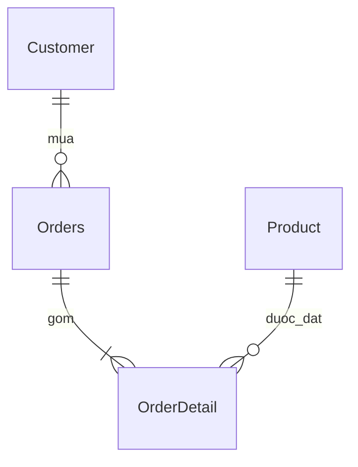

# Bài tập: Xây dựng CSDL quản lý bán hàng

## Mục tiêu
Tạo cơ sở dữ liệu `QuanLyBanHang` với 4 bảng `Customer`, `Orders`, `Product`, `OrderDetail` bằng câu lệnh SQL, sử dụng ràng buộc khóa chính, khóa ngoại, CHECK.

## Thiết kế quan hệ
- **Customer** (`cID` PK, `cName`, `cAge`): khách hàng, kể cả chưa mua hàng.
- **Orders** (`oID` PK, `cID` FK, `oDate`, `oTotalPrice`): một khách hàng có nhiều hóa đơn.
- **Product** (`pID` PK, `pName`, `pPrice`): danh mục sản phẩm.
- **OrderDetail** (`oID` PK/FK, `pID` PK/FK, `odQTY`): mỗi hóa đơn có nhiều sản phẩm; mỗi sản phẩm có thể xuất hiện trên nhiều hóa đơn; số lượng >= 1.

## Các bước chạy
1. Mở MySQL Workbench và kết nối MySQL Server.
2. Mở file [`quan_ly_ban_hang.sql`](quan_ly_ban_hang.sql) trong SQL Editor.
3. Chạy toàn bộ các lệnh (Execute).
4. Refresh SCHEMAS rồi kiểm tra `QuanLyBanHang` có bốn bảng.
5. Chạy `SHOW CREATE TABLE Orders;` và `SHOW CREATE TABLE OrderDetail;` để xem khóa ngoại.

## Ghi chú
- Tên bảng `Orders` được dùng thay `Order` vì `ORDER` là từ khóa SQL; việc đặt tên khác không thay đổi ý nghĩa nghiệp vụ.
- `oTotalPrice` là tổng tiền hóa đơn; nếu dùng trong hệ thống thực tế cần cập nhật đồng bộ theo giá và số lượng từng dòng, hoặc tính từ `OrderDetail` bằng truy vấn.
- Đây là thiết kế phù hợp mô tả văn bản. Hình cấu trúc đính kèm trong đề không truy cập được để đối chiếu tên cột và độ dài tuyệt đối; nên kiểm tra nếu giảng viên yêu cầu giống từng cột.
- Chưa có kết quả chạy thật trong Workbench; có thể bổ sung ảnh SCHEMAS và kết quả `SHOW CREATE TABLE` làm minh chứng.
